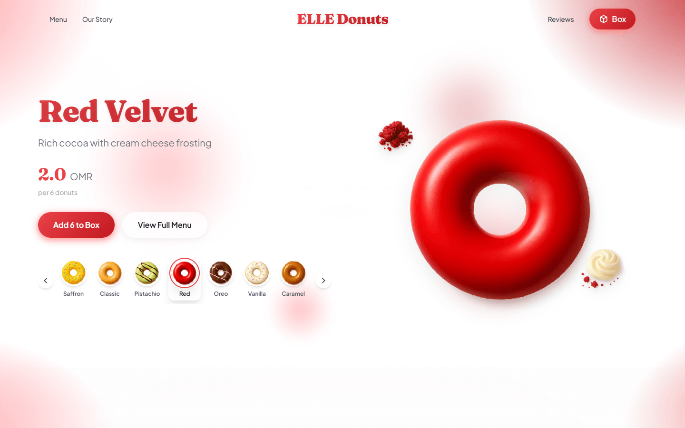
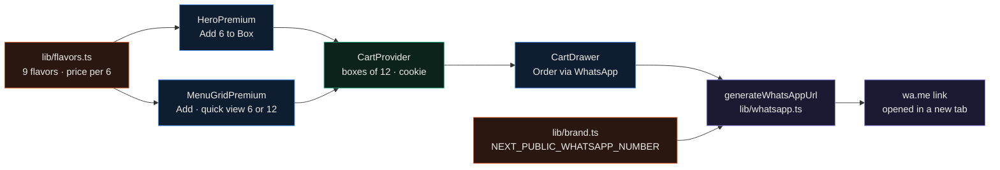
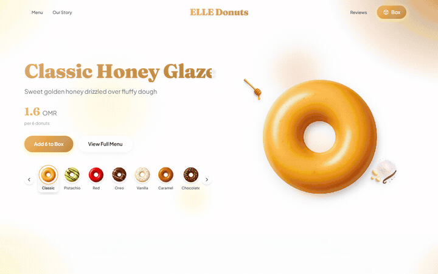
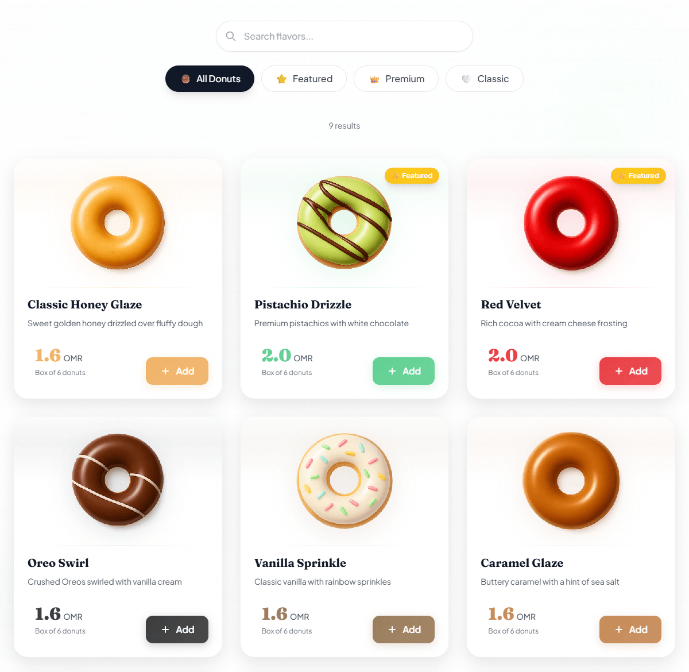
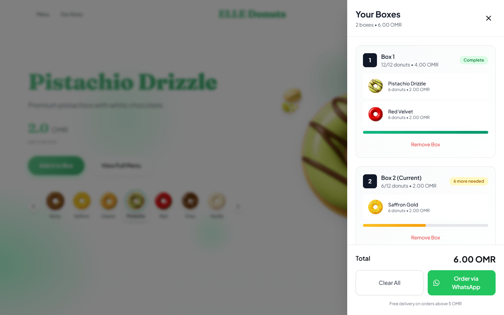
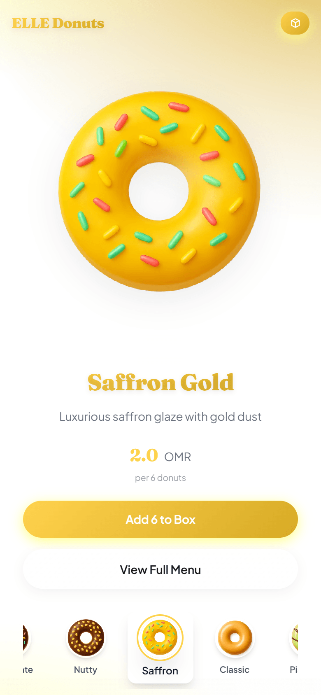
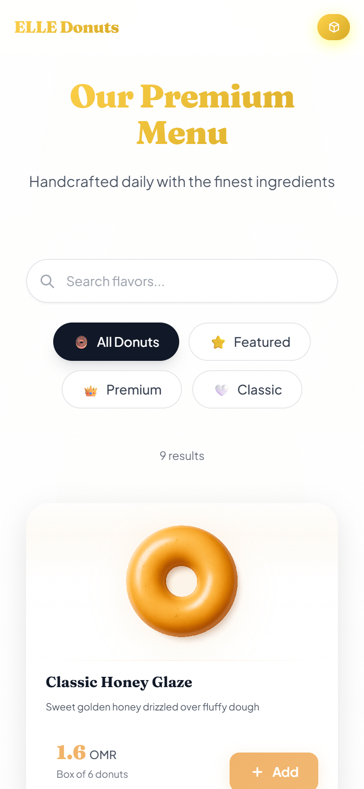
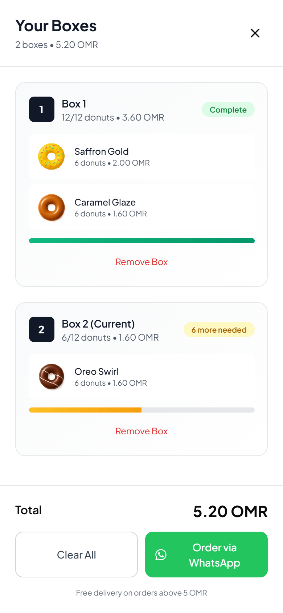

<div align="center">

# EllE Donuts

**Prototype storefront for a fictional donut shop, built with Next.js 14, where the cart turns into a prefilled WhatsApp order message.**




</div>

This is a prototype storefront for a fictional donut shop in Muscat, made as a portfolio piece. There is no real business behind it. I built it to work out a menu-to-cart flow with Framer Motion that ends in WhatsApp instead of a checkout: the cart becomes a formatted order message and opens as a `wa.me` link, with no backend at all.

---

## Highlights

- The menu has 9 flavors defined in `lib/flavors.ts`, priced at 1.6 or 2.0 OMR per 6 donuts, with a name search and four filters (all, featured, premium at 2.0 OMR and up, classic below that).
- Picking a flavor recolors the page. `ThemeProvider` derives light, dark and background shades from the flavor's accent hex and writes them to CSS variables that the header, buttons and section backgrounds read.
- The hero moves to the next flavor every 4 seconds. Choosing one by click, swipe or arrow key pauses the rotation for 10 seconds.
- The cart packs donuts into boxes of 12 in steps of 6, tops up a partly filled box before opening a new one, and keeps the boxes in a `donut_boxes` cookie for 7 days.
- The order message is built entirely in the browser by `lib/whatsapp.ts`, including per-flavor subtotals and a 1.5 OMR delivery fee for orders under 5 OMR.
- `next build` prerenders `/` as static content: 36.1 kB for the page, 162 kB first-load JS.

---

## How it works



`app/page.tsx` is the only route. It is a client component that wraps the page in `CartProvider`, so the hero, the menu cards and the cart drawer share one cart. Every add goes through `addToCurrentBox(flavor, 6)`: the provider sorts the existing boxes so the ones already holding that flavor come first, fills free slots up to 12, and opens new boxes for whatever is left. Prices are stored per 6 donuts, so a line costs `priceOMR / 6 * quantity`.

When the customer presses Order via WhatsApp, `CartDrawer` flattens the boxes into line items and passes them to `generateWhatsAppUrl`. That function merges lines by flavor, sorts them by quantity, and writes a message in WhatsApp's `*bold*` markup: an order-details block, a summary (donuts, boxes, total, delivery fee or free delivery), a request for the address and delivery time, and a timestamp in Asia/Muscat time. It strips non-digits from the configured number, URL-encodes the message into `https://wa.me/<number>?text=...` and opens it in a new tab. The shop confirms the order by hand in the chat.

For the cart in the screenshot below (6 Pistachio Drizzle, 6 Red Velvet, 6 Saffron Gold) the generated message lists 18 donuts in 2 boxes for OMR 6.00 with free delivery.

---

## Screens

Captured with headless Chrome from the production build (`next start`), at 1440x900 and at 390x844 (device scale 2), with a dummy WhatsApp number.

Picking Classic Honey Glaze, Pistachio Drizzle, Red Velvet, Saffron Gold and Oreo Swirl in the hero strip. The accent color of the whole page follows the flavor.



The menu grid with search and the four filters. Each Add puts 6 donuts in the cart; clicking a card opens a quick view that adds 6 or 12.



The cart drawer after adding three flavors from the menu: the first box is full at 12, the second holds 6.



On a phone the hero stacks vertically and the cart drawer takes the full screen.

<p align="center">
  
  
  
</p>

---

## Quickstart

Needs Node 18.17 or newer (I used Node 22.13).

```bash
git clone https://github.com/EllE961/elle-donuts.git
cd elle-donuts
npm ci
cp .env.example .env.local
```

Set the number orders should go to in `.env.local`, in international format:

```bash
NEXT_PUBLIC_WHATSAPP_NUMBER=+96800000000
```

```bash
npm run dev        # http://localhost:4000
```

The dev script pins port 4000. For a production build:

```bash
npm run build
npm start          # http://localhost:3000
```

`NEXT_PUBLIC_` variables are inlined at build time, so rebuild after changing the number. If it is left empty, the link has no recipient (`https://wa.me/?text=...`) and the footer shows a blank where the number goes.

---

## Configuration

Shop details live in `lib/brand.ts`:

| Field | Value in the repo | Where it shows up |
|---|---|---|
| `name` | `ELLE Donuts` | header logo, footer, story text, WhatsApp message |
| `tagline` | `Premium Artisan Donuts` | footer |
| `phone` | `NEXT_PUBLIC_WHATSAPP_NUMBER` | `wa.me` link, footer |
| `location` | `Muscat, Oman` | footer, WhatsApp message |
| `hours.weekdays` | `8:00 AM - 10:00 PM` | footer, as "Daily ..." |
| `currency` | `OMR` | amounts in the WhatsApp message |
| `deliveryInfo` | `Free delivery on orders above 5 OMR` | under the cart total |
| `email`, `social`, `hours.weekends`, `minOrder` | placeholders | not rendered |

Flavors (name, description, `priceOMR`, accent hex, image paths, `featured`) are in `lib/flavors.ts`. Base colors and the hero gradient are in `app/globals.css`, and the page title and Open Graph tags are in `app/layout.tsx`. The 5 OMR free-delivery threshold and the 1.5 OMR fee are hardcoded in `lib/whatsapp.ts`, separately from `deliveryInfo`, so change them together.

---

## Repository map

```text
app/
  layout.tsx            fonts, metadata, ThemeProvider
  page.tsx              the only route: header, hero, menu, story, reviews, footer, cart drawer
  globals.css           CSS variables, hero gradient, utility classes
  error.tsx             error boundary
  not-found.tsx         404 page
components/
  HeaderPremium.tsx     fixed header with the cart button
  HeroPremium.tsx       flavor carousel with auto-rotation, swipe and arrow keys
  MenuGridPremium.tsx   menu cards, search, filters, quick-view modal
  CartDrawer.tsx        boxes, totals, Order via WhatsApp
  ThemeProvider.tsx     accent hex to CSS variables
  Story.tsx             story copy and stat tiles
  Reviews.tsx           six sample reviews
  Footer.tsx            name, location, number, hours
lib/
  brand.ts              shop details (see Configuration)
  flavors.ts            the 9 flavors
  cart-context.tsx      box packing and cookie persistence
  whatsapp.ts           order message and wa.me link builder
public/assets/          donut and ingredient PNGs (AI-generated)
docs/assets/            README screenshots
.env.example            NEXT_PUBLIC_WHATSAPP_NUMBER
```

---

## Limitations

- This is a prototype for a fictional shop. The brand, the story copy and the stat tiles ("100% Fresh Daily", "9+ Unique Flavors") are placeholder content.
- The donut and ingredient images in `public/assets/` are AI-generated placeholders. All 26 PNGs carry C2PA content credentials that mark them as AI-generated.
- The six customer reviews (all five stars) and the "thousands of happy customers" line are sample content, not real feedback.
- Orders go to WhatsApp and nowhere else. There is no backend, database or payment step, and no stock or opening-hours check. The cart clears 3 seconds after the WhatsApp tab opens, whether or not the message was sent.
- "Box" means two things. Prices and Add buttons work in sixes, the cart packs boxes of 12, and the message counts "1 box" per 6 of a flavor but totals boxes of 12.
- Quick view's "Add 12" calls the add function twice in the same tick and both calls read the same cart state, so 12 of one flavor in an empty cart ends up as two boxes of 6. I reproduced this in headless Chrome.
- At 1440x900 the hero title for Classic Honey Glaze is 14 px wider than its column, and the last letter is clipped.
- `app/layout.tsx` points Open Graph at `/og-image.jpg`, which does not exist, and there is no favicon. The footer social icons link to `#`.
- Next.js is pinned at 14.2.0. `npm audit --omit=dev` reports advisories against it, one of them critical, fixed in 14.2.35. Bump it before deploying anywhere.
- There are no tests. `npm run lint` passes.

---

## License

MIT. See [LICENSE](LICENSE).
